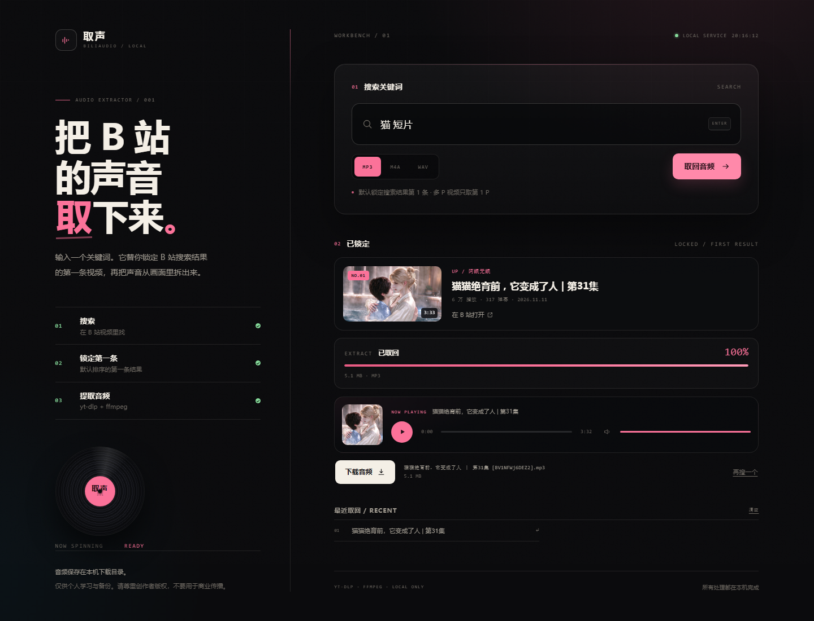

# 取声 · BiliAudio

输入一个关键词，锁定 B 站搜索结果里的**第一条视频**，返回它的链接，并用 **yt-dlp** 把音频下载到本地。

程序有两种用法：

- **本地网页界面**：搜索、看结果、下载进度、在线试听，一条龙。
- **命令行**：适合脚本调用，支持只输出链接或 JSON。

只依赖 Python、`requests`、`yt-dlp` 和 `ffmpeg`，不需要 Node，也不需要前端构建。



---

## 快速开始

### 1. 环境要求

- Python **3.10+**
- [`ffmpeg`](https://ffmpeg.org/)（`yt-dlp` 转换/封装音频需要）
- 能访问 B 站

Windows 安装 ffmpeg 的常见方式：

```powershell
winget install Gyan.FFmpeg
```

或者从 ffmpeg.org 下载压缩包，把其中的 `bin` 目录加入 `PATH`，然后确认：

```powershell
ffmpeg -version
```

macOS / Linux：

```bash
brew install ffmpeg          # macOS
sudo apt install ffmpeg      # Debian / Ubuntu
```

### 2. 安装 Python 依赖

在项目目录执行：

```bash
python -m pip install -r requirements.txt
```

如果 `yt-dlp` 不在当前 Python 环境里，程序也会尝试调用 `PATH` 中的 `yt-dlp` 命令。推荐还是装进同一个环境：

```bash
python -m pip install -U yt-dlp
```

### 3. 启动网页界面

```bash
python bili_audio.py --web
```

或者不带参数：

```bash
python bili_audio.py
```

浏览器会自动打开 `http://127.0.0.1:8765`。输入关键词，点「取回音频」即可。下载完成后可以直接在页面里试听，或点「下载音频」保存到本地。

常用参数：

```bash
python bili_audio.py --web --port 8899      # 换端口
python bili_audio.py --web --no-browser     # 不自动打开浏览器
python bili_audio.py --web --out D:\Music   # 换下载目录
```

---

## 命令行用法

```bash
# 搜索第一条并下载 MP3（默认）
python bili_audio.py "猫 短片"

# 只输出第一条视频的链接，不下载
python bili_audio.py "猫 短片" --link-only

# 指定格式与目录
python bili_audio.py "城市雨声" --format m4a --out "D:\Music"

# 输出 JSON（stdout 只有 JSON，方便 jq / 脚本处理）
python bili_audio.py "猫 短片" --format mp3 --json

# 取搜索结果里的第 3 条（默认第 1 条）
python bili_audio.py "猫 短片" --pick 3
```

关键词有空格时记得加引号。程序会把多个参数用空格拼起来，所以 `python bili_audio.py 猫 短片` 也可以，但推荐加引号避免 shell 解析差异。

默认下载目录是项目下的 `downloads/`，文件名形如：

```text
猫猫绝育前，它变成了人 ｜ 第31集 [BV1NFWj6DEZ2].mp3
```

`--link-only` 只打印：

```text
https://www.bilibili.com/video/BV1NFWj6DEZ2
```

`--json` 会返回视频信息和最终文件路径：

```json
{
  "video": {
    "bvid": "BV1NFWj6DEZ2",
    "title": "猫猫绝育前，它变成了人 | 第31集",
    "author": "阿眠无眠",
    "url": "https://www.bilibili.com/video/BV1NFWj6DEZ2",
    "duration": "3:33",
    "views": 60248
  },
  "file": "F:\\WorkSpace\\bili-audio\\downloads\\猫猫绝育前，它变成了人 ｜ 第31集 [BV1NFWj6DEZ2].mp3",
  "size": 5365820,
  "format": "mp3"
}
```

---

## 工作方式

1. 调用 B 站公开搜索接口：
   `GET https://api.bilibili.com/x/web-interface/search/type?search_type=video&keyword=...&page=1`
2. 过滤出 `type == "video"` 且带 `bvid` 的结果，按 B 站默认排序取第 1 条。
3. 拼出 `https://www.bilibili.com/video/{bvid}`。
4. 调用 `yt-dlp`：
   - `-f bestaudio/best` 只取音频流；
   - `-x --audio-format mp3` 用 ffmpeg 转成目标格式；
   - `--playlist-items 1` 对多 P 视频只取第 1 P；
   - `--force-ipv4` 规避本机 IPv6 不通导致的长时间卡住。
5. 网页端把进度以 NDJSON 流式推给浏览器；下载完成后用临时 token 提供文件，支持 `Range` 请求，所以能拖动进度条试听。

项目结构：

```text
bili-audio/
├─ bili_audio.py        # 搜索、yt-dlp 下载、命令行入口
├─ webapp.py            # 本地 HTTP 服务、NDJSON 进度流、文件 Range 服务
├─ web/
│  └─ index.html        # 网页界面（HTML/CSS/JS 单文件，无外部依赖）
├─ requirements.txt
├─ downloads/           # 默认下载目录，首次下载时自动创建
└─ README.md
```

---

## Cookies 与风控

不登录通常也能搜索和下载。如果遇到 B 站 412/403 风控，可以放一份 **Netscape 格式**的 `cookies.txt` 到项目根目录，网页端会自动读取；命令行也可以显式指定：

```bash
python bili_audio.py "猫 短片" --cookies cookies.txt
```

也可以设置环境变量：

```bash
set BILI_COOKIES=D:\path\to\cookies.txt     # Windows cmd
$env:BILI_COOKIES="D:\path\to\cookies.txt"  # PowerShell
```

网页端启动时读取一次；换了 cookies 文件需要重启服务。

> 只建议使用自己的账号 Cookie。程序不会上传 Cookie，所有请求都在本机完成。

---

## 常见问题

**下载很慢或一直卡在“解析视频信息”**

先确认 `yt-dlp` 是最新版：

```bash
python -m pip install -U yt-dlp
```

再确认 `ffmpeg -version` 可用。若日志出现 412/403，参考上面的 Cookies 配置。

**为什么要 `--force-ipv4`？**

有些 Windows 环境会先解析出 B 站的 IPv6 地址，但本机 IPv6 实际不通。`requests`/`yt-dlp` 逐个尝试地址时会卡很久。程序对搜索请求强制 IPv4，对 `yt-dlp` 子进程也加了 `--force-ipv4`。

**视频有多个 P，下载的是哪一个？**

第一个 P。命令里固定使用 `--playlist-items 1`，避免把整个合集都拖下来。

**能下载视频吗？**

这个项目的目标是“取声音”，只下载音频流并用 ffmpeg 转码；不保存视频画面。

**下载的文件在哪？**

网页模式看页面上的「下载音频」；文件实际保存在启动时 `--out` 指定的目录，默认是项目下的 `downloads/`。命令行会在结束时打印完整路径。

**搜索接口会不会失效？**

它用的是 B 站网页端公开接口，可能随站点调整或触发风控。遇到异常时先升级 `yt-dlp`、检查网络；如果接口结构变化，需要同步修改 `bili_audio.py` 里的 `search_first_video()`。

---

## 使用边界

本项目仅用于个人学习、备份与音频提取。请遵守 B 站用户协议与版权规定，不要用于批量抓取、商业传播或规避付费内容。你下载的内容版权归原作者所有。
